# 🏷️ Portfólio Profissional — Letícia Soares 👩‍💻

> [!NOTE]
> Portfólio interativo com fundo em shader WebGL que reage ao mouse, cursor próprio, tema claro/escuro e conteúdo em português e inglês.
> Identidade visual derivada do [Rana Estúdio](https://ranaestudio.com): verde e roxo saturados sobre quase-preto.

<table>
  <tr>
    <td width="800px">
      <div align="justify">
        Website de portfólio desenvolvido para o <b>Laboratório 01</b> da disciplina <i>Desenvolvimento e Integração de Aplicações Web (DIAW)</i> do curso de Engenharia de Software da PUC Minas. Apresenta trajetória, habilidades, projetos em linha do tempo, experiências e formas de contato, com formulário que envia mensagens por e-mail.
      </div>
    </td>
    <td>
      <div>
        
      </div>
    </td>
  </tr>
</table>

---

## 🚧 Status do Projeto


---

## 📚 Índice

- [Links Úteis](#-links-úteis)
- [Sobre o Projeto](#-sobre-o-projeto)
- [Funcionalidades Principais](#-funcionalidades-principais)
- [Tecnologias Utilizadas](#-tecnologias-utilizadas)
- [Arquitetura](#-arquitetura)
- [Instalação e Execução](#-instalação-e-execução)
- [Deploy](#-deploy)
- [Estrutura de Pastas](#-estrutura-de-pastas)
- [Wireframes](#-wireframes)
- [Demonstração](#-demonstração)
- [Testes](#-testes)
- [Documentações utilizadas](#-documentações-utilizadas)
- [Autores](#-autores)
- [Licença](#-licença)

---

## 🔗 Links Úteis

- 🌐 **Site publicado:** [portfolio-profissional-rust.vercel.app](https://portfolio-profissional-rust.vercel.app/)
- 📐 **Protótipos (Figma):** [portfolio-wireframes](https://www.figma.com/design/vhOdIobyJ8Vn1V6iLGHWOT/portfolio-wireframes) — imagens em [Wireframes](#-wireframes)
- 🐸 **Projeto de referência:** [Rana Estúdio](https://ranaestudio.com)

---

## 📝 Sobre o Projeto

O portfólio reúne, em uma página única com menu de navegação, as quatro seções pedidas pelo Product Owner: **Sobre Mim**, **Projetos**, **Experiências** e **Contato**.

A proposta visual é tratar o fundo como superfície viva: uma "água" gerada em shader que se mexe sozinha, foge do cursor e abre ondas a cada clique. As seções sobem por cima com vidro fosco, preservando a leitura sem esconder o movimento.

---

## ✨ Funcionalidades Principais

- **Sobre Mim** em português e inglês, com troca animada e preferência salva no navegador.
- **Projetos** em linha do tempo (do mais antigo ao mais recente), com linha que se preenche ao rolar, filtro por tecnologia e modal com imagem/GIF, tecnologias e links para GitHub e site.
- **Experiências** em lista expansível: instituição, cargo, período, tipo e descrição.
- **Contato** com ícones para e-mail, WhatsApp, LinkedIn e GitHub e formulário validado (nome, e-mail, mensagem) que envia por e-mail via EmailJS.
- **Fundo interativo** em WebGL: fluxo contínuo, deformação ao redor do ponteiro e ondas ao clicar.
- **Cursor próprio**: ponto + anel com rastro, cresce sobre links, vira barra sobre campos de texto e mostra rótulo "abrir" nos projetos.
- **Tema claro e escuro** respeitando a preferência do sistema, sem piscar no carregamento.
- Microinterações: letras do nome que pulam no hover, foto com inclinação 3D, botões magnéticos, barra de progresso de leitura.
- **Responsivo** (menu móvel) e **acessível**: navegação por teclado, `aria-*`, foco visível e `prefers-reduced-motion`.

---

## 🛠 Tecnologias Utilizadas

### 💻 Front-end

| Tecnologia | Uso |
|---|---|
| [React 19](https://react.dev/) | Interface em componentes |
| [TypeScript](https://www.typescriptlang.org/) | Tipagem do código e do conteúdo |
| [Vite 8](https://vite.dev/) | Dev server e build |
| [Tailwind CSS 4](https://tailwindcss.com/) | Estilização com tokens de tema em CSS |
| [Three.js](https://threejs.org/) | Shader do fundo interativo |
| [Motion (Framer Motion)](https://motion.dev/) | Animações, layout e transições |
| [React Hook Form](https://react-hook-form.com/) | Estado e validação do formulário |
| [EmailJS](https://www.emailjs.com/) | Envio de e-mail direto do front-end |
| [Fontsource](https://fontsource.org/) | Unbounded, Space Grotesk e Space Mono auto-hospedadas |

### 🖥️ Back-end

Não há back-end próprio: o envio de e-mail é delegado ao EmailJS.

### ⚙️ Infraestrutura & DevOps

- **Hospedagem:** Vercel (plano gratuito)
- **Versionamento:** Git + GitHub
- **Qualidade:** ESLint + `tsc` em modo estrito

---

## 🏗 Arquitetura

SPA estática. O conteúdo fica separado dos componentes; os componentes leem idioma e tema de um contexto único.

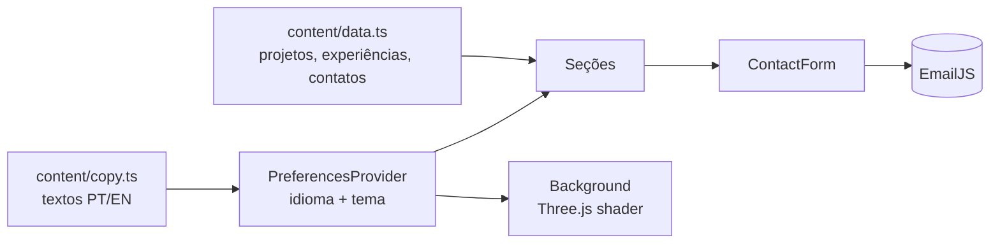

- **Conteúdo como dado:** adicionar um projeto é incluir um objeto em `src/content/data.ts`.
- **Tema por tokens CSS:** `index.css` define as variáveis de cada tema; o Tailwind as expõe como utilitários (`bg-fundo`, `text-verde`…). O shader lê as mesmas variáveis.
- **Carregamento sob demanda:** o Three.js é importado dinamicamente, sem bloquear a primeira pintura.

---

## 🔧 Instalação e Execução

### Pré-requisitos

- [Node.js](https://nodejs.org/) 20+ e npm

### 🔑 Variáveis de Ambiente

Copie `.env.example` para `.env.local` e preencha com as chaves do EmailJS:

```env
VITE_EMAILJS_SERVICE_ID=service_xxxxx
VITE_EMAILJS_TEMPLATE_ID=template_xxxxx
VITE_EMAILJS_PUBLIC_KEY=xxxxxxxxxxxx
```

No template do EmailJS, use as variáveis `{{from_name}}`, `{{reply_to}}` e `{{message}}`. Sem essas chaves, o site funciona e o formulário avisa que o envio não está configurado.

> **Obs:** em projetos Vite as variáveis precisam do prefixo `VITE_` para chegar ao código do cliente.

### 📦 Instalação de Dependências

```bash
git clone https://github.com/Leticia-soares404/portfolio-profissional.git
cd portfolio-profissional
npm install
```

### ⚡ Como Executar a Aplicação

```bash
npm run dev       # desenvolvimento em http://localhost:5173
npm run build     # typecheck + build de produção em dist/
npm run preview   # serve o build localmente
npm run lint      # ESLint
```

---

## 🚀 Deploy

1. Importar o repositório em [vercel.com/new](https://vercel.com/new) (framework detectado: **Vite**).
2. Em **Settings → Environment Variables**, cadastrar as três variáveis `VITE_EMAILJS_*`.
3. Deploy. Cada push na `main` publica automaticamente; branches geram _preview deployments_.

---

## 📂 Estrutura de Pastas

```
.
├── docs/
│   ├── img/                   # screenshots do site
│   └── wireframes/            # wireframes de média fidelidade
├── public/
│   ├── projetos/              # imagens/GIFs dos projetos
│   ├── favicon.svg
│   └── leticia.jpg
├── src/
│   ├── components/
│   │   ├── background-scene.ts  # shader Three.js (fluxo, mouse, ondas)
│   │   ├── Background.tsx       # monta a cena e sincroniza com o tema
│   │   ├── Cursor.tsx           # cursor próprio
│   │   ├── Header.tsx           # menu, idioma, tema, progresso
│   │   ├── Hero.tsx
│   │   ├── About.tsx
│   │   ├── Projects.tsx         # timeline + filtro
│   │   ├── ProjectModal.tsx
│   │   ├── ProjectMedia.tsx
│   │   ├── Experiences.tsx
│   │   ├── Contact.tsx
│   │   ├── ContactForm.tsx
│   │   ├── Footer.tsx
│   │   ├── Icons.tsx
│   │   ├── Section.tsx
│   │   └── SectionHeader.tsx
│   ├── content/
│   │   ├── copy.ts            # textos da interface PT/EN
│   │   ├── data.ts            # projetos, experiências, contatos, skills
│   │   └── types.ts
│   ├── hooks/                 # useReveal, useActiveSection, useMagnetic
│   ├── lib/                   # preferências (idioma/tema) e envio de e-mail
│   ├── App.tsx
│   ├── index.css              # tokens de tema e estilos base
│   └── main.tsx
├── .env.example
├── index.html
├── package.json
└── vite.config.ts
```

---

## 📐 Wireframes

Wireframes de média fidelidade das telas desktop (1440 px) e mobile (390 px), também disponíveis no [Figma](https://www.figma.com/design/vhOdIobyJ8Vn1V6iLGHWOT/portfolio-wireframes). O painel laranja à direita de cada tela descreve as interações previstas.

| Desktop | |
|---|---|
| 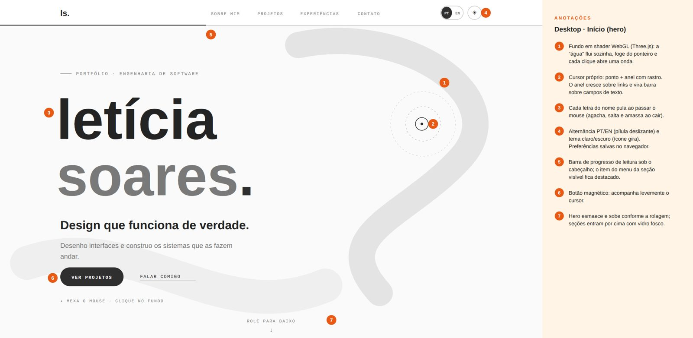 | 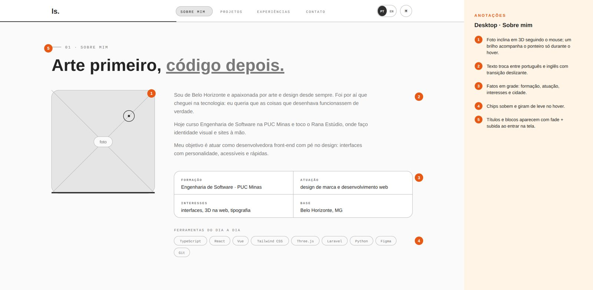 |
| 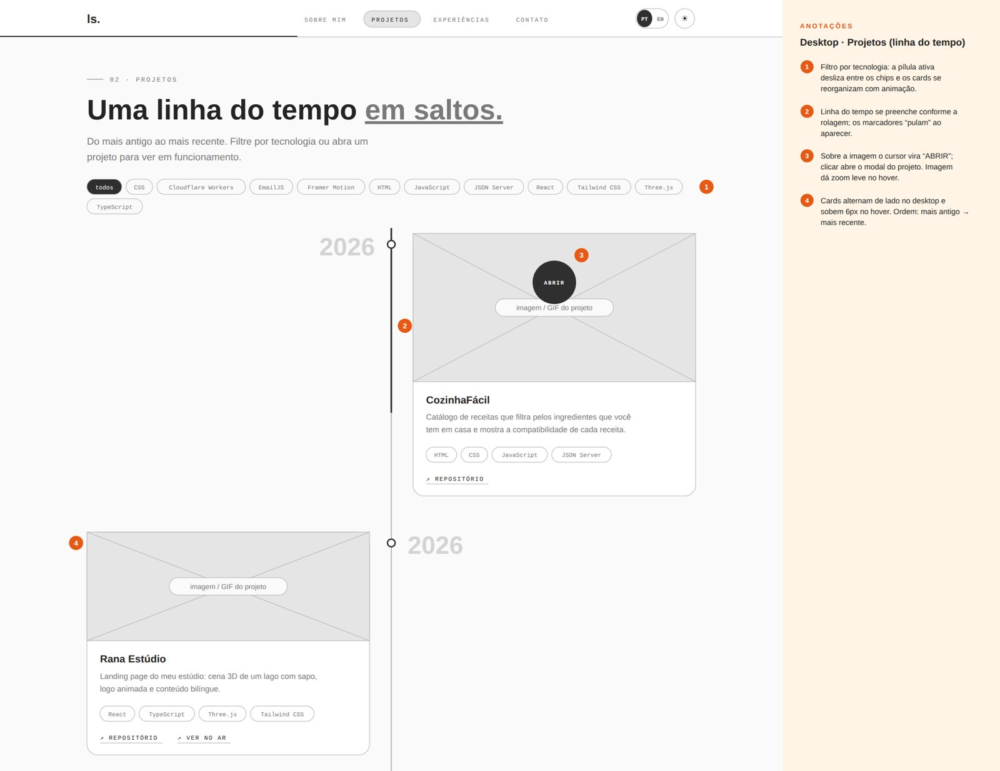 | 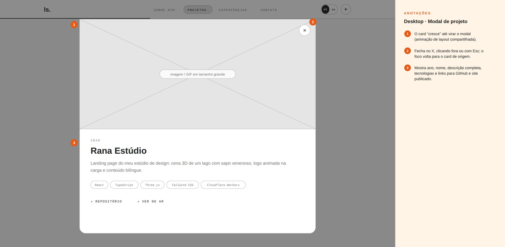 |
| 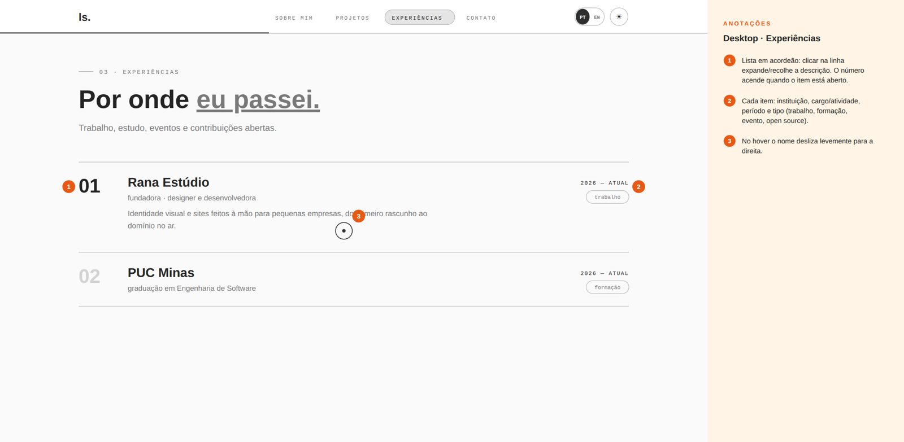 | 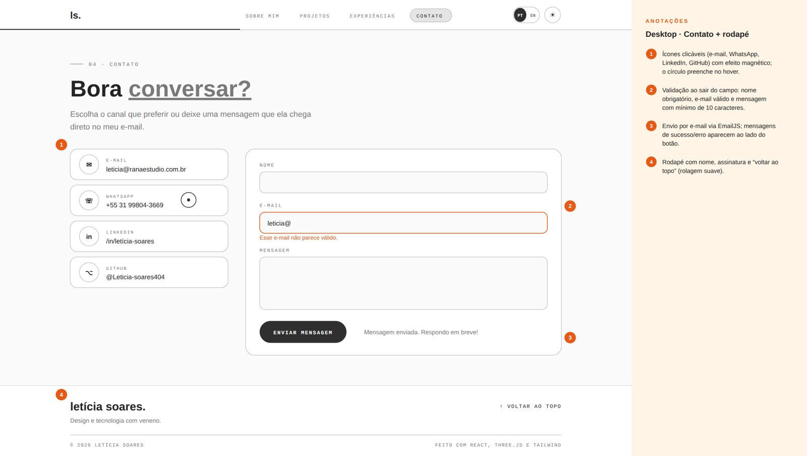 |

| Mobile | | | |
|---|---|---|---|
| 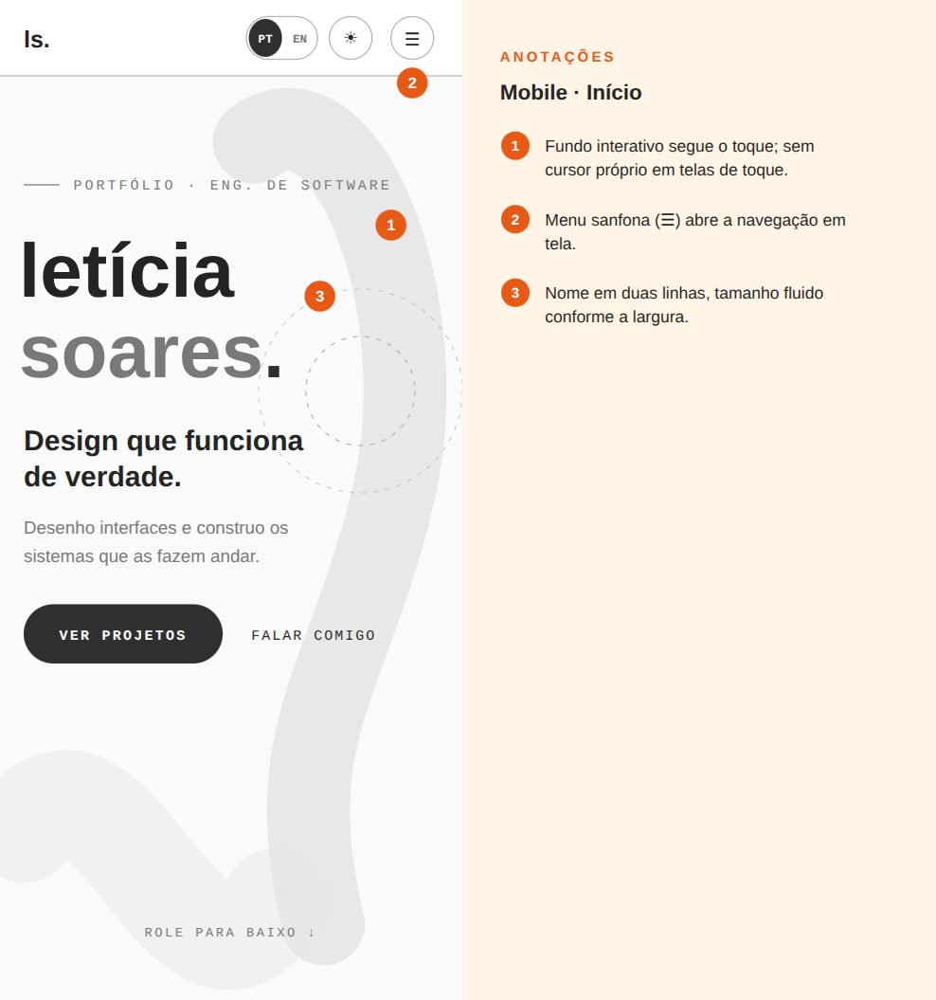 | 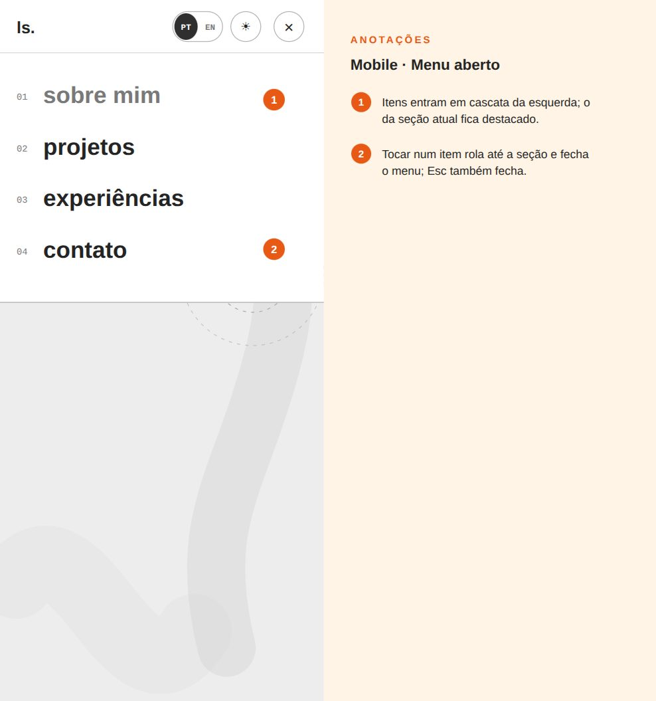 | 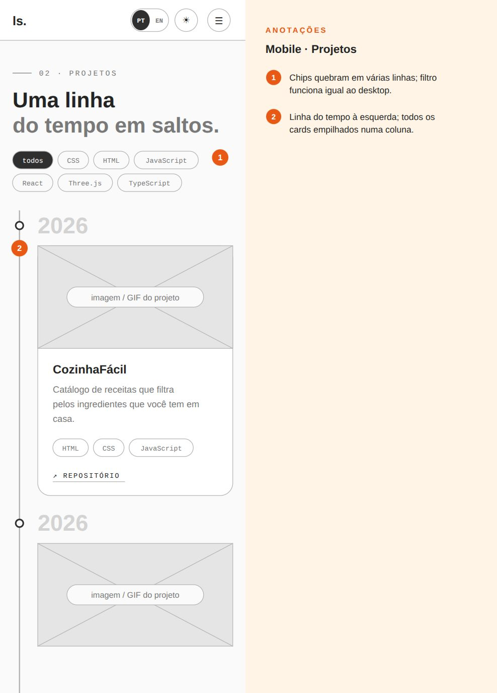 | 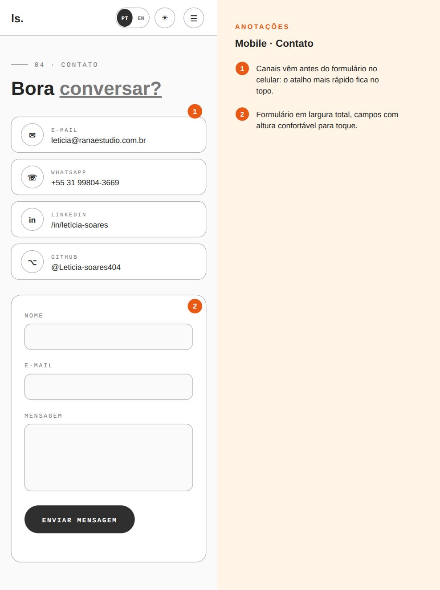 |

---

## 🎥 Demonstração

### 🌐 Aplicação Web

| Tema escuro | Tema claro |
|---|---|
| 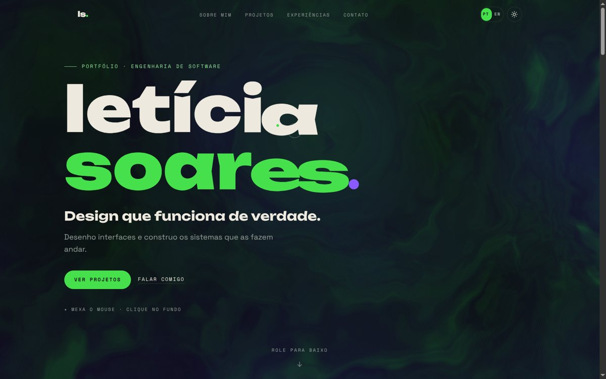 | 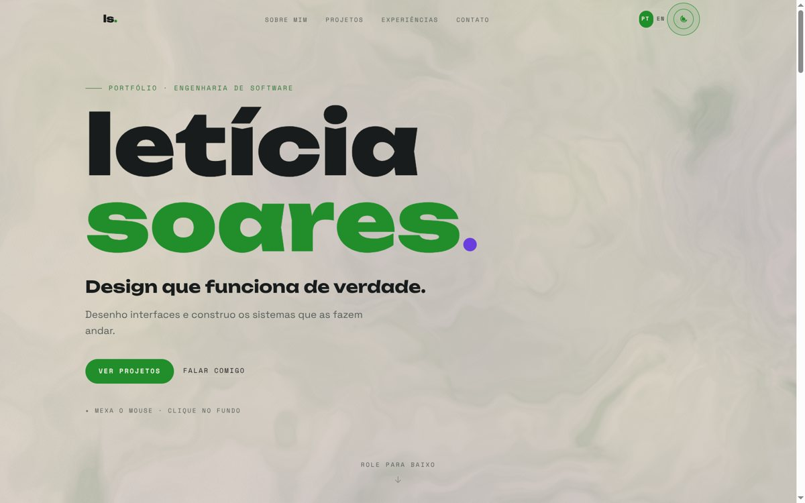 |

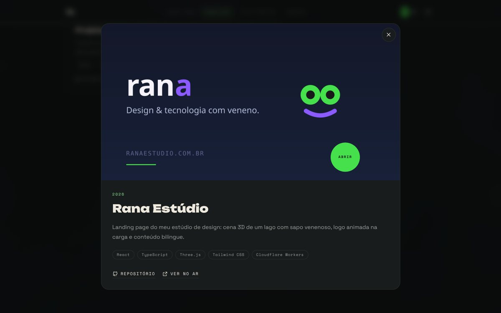

| Mobile | Menu mobile |
|---|---|
| 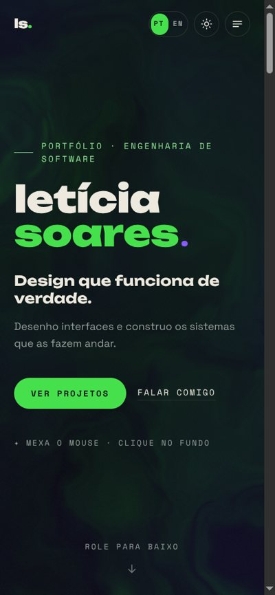 | 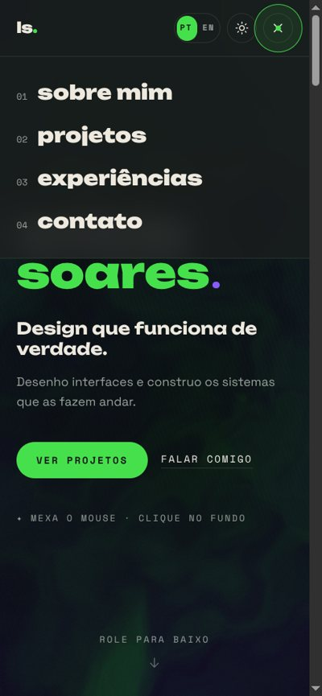 |

---

## 🧪 Testes

Validação local e manual:

- `npm run lint` e `npm run build` (inclui `tsc` estrito) sem erros.
- Conferência visual em desktop (1440×900), tablet e mobile (390×844), nos dois temas e nos dois idiomas.
- Formulário: campos vazios, e-mail inválido, mensagem curta e envio sem EmailJS configurado.

---

## 🔗 Documentações utilizadas

- [React](https://react.dev/reference/react)
- [Tailwind CSS v4 — Theme variables](https://tailwindcss.com/docs/theme)
- [Three.js — ShaderMaterial](https://threejs.org/docs/#api/en/materials/ShaderMaterial)
- [Motion for React](https://motion.dev/docs/react)
- [React Hook Form](https://react-hook-form.com/docs)
- [EmailJS — Browser SDK](https://www.emailjs.com/docs/sdk/installation/)
- [Vercel — Vite](https://vercel.com/docs/frameworks/frontend/vite)

---

## 👥 Autores

| Nome | GitHub |
|---|---|
| Letícia Soares | [@Leticia-soares404](https://github.com/Leticia-soares404) |

---

## 📄 Licença

Projeto acadêmico. Código sob licença [MIT](https://opensource.org/licenses/MIT).
